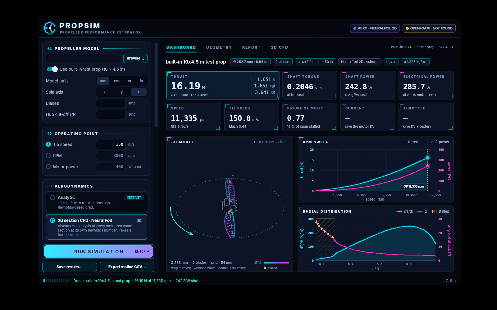
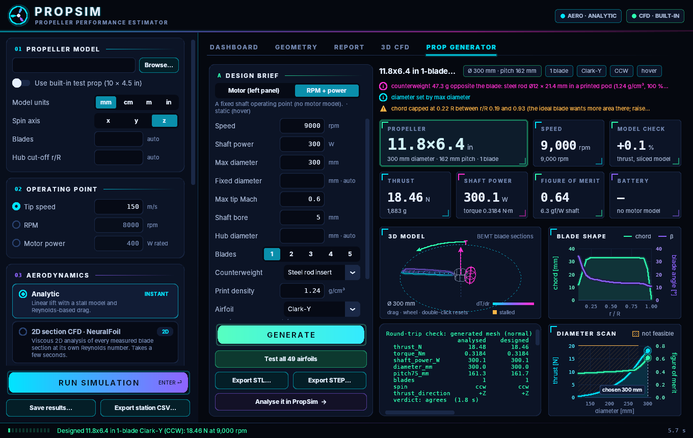

DISCLAIMER: This Repository contains AI generated CODE

# PropSim: propeller simulator and generator

PropSim estimates a propeller's **thrust, torque and power straight from its 3D model** (STL or STEP), and **designs new propellers** for your motor, battery and flight condition, ready for 3D printing, moulding or machining.

It works as a Windows desktop app and as Python command-line tools. You can pick one of three levels of aerodynamics, from instant to hours:

| Level | Method | Time |
|---|---|---|
| Analytic | Blade Element Momentum Theory (BEMT) with a generic airfoil model | instant |
| 2D section analysis | BEMT with a viscous 2D analysis of every measured blade section ([NeuralFoil](https://github.com/peterdsharpe/NeuralFoil)) | seconds |
| 3D CFD | OpenFOAM: steady RANS (k-ω SST) with a rotating MRF zone, meshed with snappyHexMesh | minutes to hours |

> [!WARNING]
> **These are estimates, not measurements.** Read the [disclaimers](#disclaimers) before you build or spin anything this software produces.

## Features

- **Analyse any prop from its 3D model.** The mesh is sliced into blade sections, and chord, twist, pitch, thickness, camber, blade count and hub are measured from those sections. You can run it at a set tip speed or rpm, or for a given motor (KV, rated power, battery voltage, winding resistance and no-load current), including current and throttle.
- **Forward flight and hover**, with Prandtl tip loss, wake swirl, compressibility, transonic wave drag and post-stall behaviour.
- **3D CFD on Windows with nothing to install.** A native Windows build of OpenFOAM v1912 ships next to the app, with incompressible (simpleFoam) and compressible (rhoSimpleFoam) air. It runs on all CPU cores, and it falls back to a single core if the parallel run can't start or crashes.
- **Prop Generator.** It designs the ideal minimum-induced-loss propeller for maximum thrust, best efficiency or a target thrust, then exports it as STL or STEP. It also checks the design by slicing its own 3D model and analysing it like any other prop.
  - **49 airfoils** in 7 groups, using real coordinates from the UIUC database: classic propeller sections, NACA, Hepperle MH, low Reynolds number, high-speed NACA 16/6-series, supercritical, and experimental supersonic sections (biconvex, double wedge).
  - **Test all airfoils:** designs the prop with every airfoil and ranks them, using all CPU cores.
  - **1 to 5 blades.** A single blade gets an automatically sized counterweight, solid or holding a metal rod insert, for any material (printing plastics, injection-moulding nylons, POM, PC, composites, wood, aluminium), and the prop comes out statically and dynamically balanced.
  - **Set the pitch yourself** (at 75 % radius with the optimum twist shape, or constant along the blade), or let it find the optimum. The design airspeed and air density shape the blade.
  - **Strength-aware design:** pick the material (about 120: generic grades of printing, moulding and machining plastics, resins, composites, wood, aluminium, titanium, steels and stainless, plus the catalogues of JLC3DP, PCBWay and SendCutSend under their own names) and the manufacturing process (including SLM metal printing, binder jetting and sheet cutting), and the blade is checked for centrifugal, bending and torsional stress, fatigue, hub stress and deflection against a safety factor. It can design within those limits (thicker root, bigger hub, or a slower prop) or just report them.
  - **Resonance check:** the blade's flap, lag and torsion natural frequencies (finite-element beam, with centrifugal stiffening) are compared with 1P–4P excitation at the operating speed, with a Campbell diagram in the app.
  - **Hub options:** spinner (cone, dome, ogive), rounded or chamfered edges, mounting holes with countersinks or counterbores, D-flat, set screw, prop-nut pocket, bore tolerance, blade-root fillet and blade offset.
  - **STL and STEP with every detail:** the STEP is one closed solid with tubercles, teeth, winglets and hub options, either an exact copy of the STL's surface or a smoother, lighter version. The app's 3D view shows the real shaded model, or the analysed blade sections.
  - **Experimental blade features:** swept (scimitar) blades, serrated trailing edges, leading-edge tubercles, winglets and raked tips, built into the model, with their effect estimated (and labelled as rough).
  - Tip Mach up to 1.3 and airspeed up to 300 m/s, with transonic and supersonic wave-drag estimates.

## Getting started

### Windows app

1. Download `PropSim-windows.zip` from the [Releases](../../releases) page.
2. Extract the **whole** zip. Keep the `cfd-engine` folder next to `PropSim.exe`, because the 3D CFD tab needs it.
3. Run `PropSim.exe`. The exe is not code-signed, so Windows SmartScreen may warn you the first time: choose *More info → Run anyway*.

The full manual is in [docs/USER_GUIDE.md](docs/USER_GUIDE.md). It covers every option (including the command-line tools), the model setup, how the methods work, and their accuracy.

## What's new

See [CHANGELOG.md](CHANGELOG.md) for the changes in each release. The latest adds blade strength and resonance checks, a material catalogue with JLC3DP, PCBWay and SendCutSend grades, hub options (spinner, mounting holes, D-flat, set screw, fillet), STEP files that keep every detail of the STL, compressible 3D CFD, experimental blade features and a smoother interface.

## Accuracy

| Check | Result |
|---|---|
| BEMT in general | typically ±15–25 % of measured thrust and power, and reads optimistic |
| Built-in test prop, 8000 rpm hover: BEMT vs 3D CFD (coarse mesh) | thrust 7.93 N vs 6.34 N; torque 0.110 vs 0.105 N·m |
| Prop Generator round trip (design vs. its own sliced 3D model) | within 0.3 % on ordinary designs, within 2 % on transonic ones |
| Compressible 3D CFD, 10x17.2 in at 150 m/s, tip Mach 0.92 (coarse mesh) | blade thrust 33.0 N compressible vs 24.3 N incompressible; BEMT 42.5 N |
| STEP export | one closed, valid solid; surface within 0.1 mm of the STL; reloaded into PropSim within 0.2 % thrust |
| Blade strength model | matches textbook centrifugal stress and cantilever deflection exactly |
| Resonance check | spinning cantilever within 0.01 % of Wright et al. (1982) |

The round trip and the strength and resonance checks show that the models are implemented correctly. They do **not** show that the predictions match reality. Only a thrust stand (and a guarded spin test) does that.

## Disclaimers

**No warranty.** This software is provided "as is", without warranty of any kind, express or implied. Use it at your own risk. The authors are not liable for any damage, injury or loss arising from its use, including from propellers designed, analysed or built with it.

**Estimates only.** All results come from simplified engineering models: BEMT, 2D section analysis, and coarse-mesh CFD. Real thrust, power, current and loads can differ substantially. Confirm every design on a thrust stand before relying on it, and never use these numbers alone to size a motor, ESC, battery or airframe.

**Not for safety-critical or certified use.** PropSim is not validated for full-size aircraft, people-carrying vehicles, or any certified or safety-critical application. Don't use it for those.

**Spinning propellers are dangerous.** They can cause severe injuries.
- Test with the prop guarded, the model restrained, and people out of the prop's plane of rotation.
- Never stand in line with a running prop.
- Follow your local laws and flying-field rules.

**Propellers you make can fail.** PropSim's strength check is a simple beam model with typical material data. It is **not** a certified stress analysis. Its resonance check assumes a rigid hub and motor. It does **not** check flutter, impact, creep or heat, however the prop is made (3D printed, moulded, machined or laminated).
- A blade can break or throw parts at high rpm. For printed props, layer adhesion, infill, print orientation, temperature and age all matter; for moulded ones, material grade, fibre orientation, weld lines, voids and moisture.
- Swept blades, serrated trailing edges and winglets change how a blade bends and twists, and teeth make thin, notch-sensitive edges.
- Inspect every prop. Balance it on a prop balancer, and spin it up gradually behind a guard before use.
- Don't exceed the material's limits. Hobby filaments soften well below 100 °C, and PLA creeps under load.

**Single-blade counterweights** are sized from the 3D model's ideal mass distribution and assume a fully solid part (100 % infill if printed) at the material density you enter. Real parts vary, so check the balance yourself before running the prop, and make sure metal inserts are pressed, bonded or moulded in securely. A loose insert at speed is a projectile.

**Experimental blade features** (sweep, serrations, tubercles, winglets, raked tips) are modelled with simple engineering estimates, not measured or computed flow. Treat their predicted gains and losses as rough.

**High tip speeds.** Above about Mach 0.75 the results are increasingly rough estimates. Above Mach 1 (supersonic tips) they are experimental.
- Fast tips mean extreme noise, very high blade loads, and sometimes violent vibration.
- Don't build or run transonic or supersonic propellers without proper engineering, testing facilities and hearing protection.

**3D CFD.** The coarse mesh is a quick check, not a converged answer. Fast props use the compressible solver (rhoSimpleFoam) automatically; with the incompressible one, loads above about tip Mach 0.6 come out too low, and the app says so. Above about Mach 0.9 shocks make every method here rough. Results depend on mesh resolution, and a run can diverge. The bundled Windows OpenFOAM engine is an unofficial build, tested on only a few Windows PCs.

**Units and model setup.** Wrong units, axis or blade count give wrong results without any error. Always check the reported diameter, pitch and blade count against what you expect.

## Third-party software and data

- **NeuralFoil** © Peter Sharpe, MIT License (`nf_weights/LICENSE-NeuralFoil.txt`), vendored as pure numpy.
- **Airfoil coordinates** come from the UIUC Airfoil Coordinates Database (M. Selig, University of Illinois), via AeroSandbox (MIT).
- **OpenFOAM®** is a registered trade mark of OpenCFD Ltd. The bundled engine (`cfd-engine/` in the Windows release) is an unofficial build of OpenFOAM v1912's GPL v3 source. It is not approved or endorsed by OpenCFD Ltd, owner of the OpenFOAM trade mark. See `cfd-engine/COPYING` and `cfd-engine/NOTICE.txt` for the licence and the source location. Rebuild it with `tools/build_cfd_engine.sh`.
- **Microsoft MPI** 10.1.1 runtime (`msmpi.dll`, `mpiexec.exe`, `smpd.exe`) is included for parallel CFD runs, under the MIT licence (`cfd-engine/licenses/MS-MPI-LICENSE.txt`).
- **gmsh** (GPL v2 or later) reads and writes STEP files. It is optional for the command line and bundled inside `PropSim.exe`.
- Other Python libraries: numpy, scipy, trimesh, manifold3d and customtkinter. PyInstaller builds the exe.

## License

PropSim's own source code is licensed under the **GNU General Public License v3.0** (see [LICENSE](LICENSE)). The third-party components above keep their own licences. The Windows release includes GPL-licensed binaries (OpenFOAM, and gmsh inside the exe); `cfd-engine/NOTICE.txt` gives the OpenFOAM source location.
